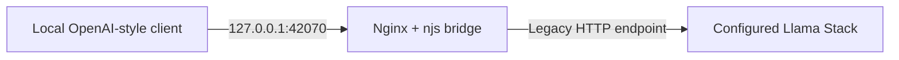

# Llama Stack Bridge

**Maturity: experimental — release hardening in progress. NOT stable, beta-qualified, or production-ready.**

A small, local-first Nginx + njs adapter for a **limited legacy Meta Llama Stack API**. It translates model listings and **non-streaming, text-only** chat responses into OpenAI-style JSON. The implementation is not an official Meta/OpenAI integration and does not promise complete OpenAI API compatibility.

> This documentation describes the isolated `release-readiness/2026-10-13-doc-app` development branch. The published `main` branch remains the old 2024 prototype until explicitly reviewed and merged.

## Request flow



The public HTTP interface is loopback-bound by default. The bridge **has no authentication or TLS**. Keep it on a trusted local machine; do not change the port binding to `0.0.0.0` or expose it through a reverse proxy without a separately reviewed access-control design.

## Scope — what does and does not work

| Endpoint / capability | Source implementation | Qualification |
| --- | --- | --- |
| `GET /v1/models` (alias `/models`) | Maps legacy `GET /models/list` results to model-list JSON | Synthetic tests; live upstream unverified |
| `POST /v1/chat/completions` (alias `/chat/completions`) | Maps legacy `POST /inference/chat_completion` results to non-streaming text completions | Synthetic tests; live upstream unverified |
| `GET /healthz` | Reports Nginx service availability | Not proof the upstream is available |
| Invalid inputs, unsupported options | Returns structured 400 responses | Covered by mock-based tests |
| `stream: true` | Rejects with 501, not silently accepted | Not implemented |
| Tools/function calls, images, audio, JSON schema, multimodal messages, `/v1/responses` | Unsupported; no translation promised | Not implemented |
| Native OpenAI authentication, TLS, upstream bearer token forwarding | Unsupported | No internet/LAN deployment |

The adapter currently accepts a `model` string, nonempty `messages` of text-only `system`/`user`/`assistant` roles, plus optional `max_tokens` (nested under legacy `sampling_params`). Sampling strategy controls such as `temperature`, `top_p`, `top_k` and `repeat_penalty` are now rejected rather than falsely forwarded as flat fields. Other fields fail closed instead of silently changing their meaning. It maps older Llama Stack `completion_message` response shapes and normalizes ordinary token usage. **Modern Llama Stack may use different routes or schemas.**

**Legacy source contract:** On 15 October 2026, source inspection pinned a
historical [Llama Stack inference API revision](https://github.com/meta-llama/llama-stack/blob/37b330b4ef24a9253abba07cf906bf4ac3af6e55/llama_stack/apis/inference/inference.py)
(31 October 2024) and its [model-list API](https://github.com/meta-llama/llama-stack/blob/37b330b4ef24a9253abba07cf906bf4ac3af6e55/llama_stack/apis/models/models.py).
That revision uses legacy `/inference/chat_completion` and `/models/list`
routes, the `model` request field, and nested `sampling_params`.
The bridge now translates `max_tokens` into the nested structure and
rejects other unverified sampling options. **This establishes a
source-level reference, not a pinned deployable upstream version or
live compatibility evidence.**

## Developer quick start — isolated experiments only

**Prerequisites:** Docker Engine with Compose v2, an accessible legacy Llama Stack HTTP server, and a trusted local development environment. An upstream bound only to the Docker host's `127.0.0.1` may **not** be reachable via `host.docker.internal` inside the container; arrange a safely accessible Docker-network endpoint rather than exposing the upstream to the internet.

1. Clone this repository and switch to the isolated review branch (until its changes are merged):

   ```sh
   git clone https://github.com/matthewhand/llama-stack-bridge.git
   cd llama-stack-bridge
   git switch release-readiness/2026-10-13-doc-app
   cp .env.sample .env
   ```

2. Set `UPSTREAM_HOST` and `UPSTREAM_PORT` in `.env`. Host accepts a DNS name or IPv4 address; port must be between 1 and 65535. Do not include `http://`, URL paths, or credentials. The sample uses `host.docker.internal:42069`, which only works when a suitable Docker host gateway is reachable.

3. Once the operator approves a disposable build, run:

   ```sh
   docker compose build
   docker compose up -d
   curl -fsS http://127.0.0.1:42070/healthz
   curl -fsS http://127.0.0.1:42070/v1/models
   ```

   `/healthz` confirms only that Nginx responds. For an actual chat test, select a real model identifier returned by the upstream:

   ```sh
   curl -fsS http://127.0.0.1:42070/v1/chat/completions \
     -H 'Content-Type: application/json' \
     -d '{"model":"REPLACE_WITH_MODEL_ID","messages":[{"role":"user","content":"Synthetic hello"}]}'
   ```

4. Inspect results without using private prompts. Stop the isolated environment when finished with `docker compose down`. Do not run this example against production endpoints without independent security and compatibility reviews.

The Compose service runs unprivileged, drops Linux capabilities, uses a read-only filesystem with a bounded temporary directory, disables Nginx access logging, and binds only `127.0.0.1:42070` on the host. These are **source-level controls, not a substitute for a completed runtime security test**.

## Local tests (no hosted CI)

Node.js 20+ is required **only for the test harness**, not inside the Nginx container. There are no npm dependencies to install.

```sh
node --test tests/*.test.mjs
python3 -B -m unittest discover -s tests -p 'test_*.py' -v
python3 -B tests/verify_http.py --self-test
python3 -O tests/verify_http.py --self-test
```

On 15 October 2026, the existing **23 JavaScript tests passed 23/23 under
actual Node.js v22.22.3 on Ubuntu-GTX** (18 translation checks and five
source/deployment checks). The new **eight Python offline harness tests
passed 8/8**, including mock HTTP observations, exact wrong-payload and
leaked-header detection, and both ordinary and optimized-Python
negative controls. These tests use fictional data. This is **not**
evidence of a running Nginx container or a compatible live Llama
Stack server. No containers have been built or executed.

No GitHub Actions workflow is supplied or needed. Do not enable hosted CI on private repositories.

### Disposable runtime qualification (not yet executed)

See [tests/VERIFICATION.md](tests/VERIFICATION.md) for the **existing,
approval-gated runtime acceptance procedure** and its three files:
`mock_upstream.py`, `verify_http.py` and `runtime.compose.yaml`.
A dedicated disposable Linux VM, a distinct Docker daemon, adequate
headroom, verified immutable base-image/Python-image digests, explicit
permission for downloads/builds and separate permission for container
execution are required **before** use. The fixture must not connect to
production or handle real prompts. The bridge entrypoint now supports
`--check` to run the same configuration validation and `nginx -t` in
a one-shot container **before starting regular Nginx workers**.

The disposable Compose file uses a project-specific namespace and
ownership labels. These do not by themselves establish network
isolation, provenance, absence of leaks or complete cleanup. Independent
runtime inspection remains mandatory.

## Important limitations

See [SECURITY.md](SECURITY.md) for the full trust-boundary and privacy review.

- **Upstream dependency:** this translation targets an older Llama Stack API, not contemporary universal OpenAI API compatibility.
- **Security:** no endpoint authentication, no HTTPS, and no support for an authenticated upstream. Default bind is loopback only; even locally, another process may call this bridge.
- **Content:** text-only chat. Streaming, tools and nontext message content are intentionally rejected.
- **Resource limits:** the Nginx config caps request body size at 64 KiB and buffered subrequest responses at 1 MiB; long histories and large replies can fail.
- **Error behavior:** invalid user requests return HTTP 400; unsupported streaming returns 501; upstream failures or malformed upstream responses return generic 502 without returning upstream bodies to clients.
- **Build reproducibility:** normal development builds default to Alpine 3.22; an immutable base-image reference is injectable using the `ALPINE_BASE` build argument. The disposable verification Compose file requires a digest value, but Alpine package indexes and package checksums are not yet reproducibly pinned. Fresh-build proof and a dependency vulnerability assessment are still required.
- **Releases:** no verified live Llama Stack version matrix, independent load test or production incident runbook exists.

## Release acceptance gates

- [x] Separate original prototype claims from demonstrated functionality.
- [x] Add fail-closed synthetic API checks and remove conversation-body debug logging in source.
- [x] Add rootless, loopback-only Compose configuration and explicit validated upstream substitution in source.
- [x] Run the Node 20+ unit/source suite locally (23/23 on Node v22.22.3, 15 October 2026) and Python offline harness checks (8/8).
- [ ] Independently build the image and run `nginx -t` from a clean checkout on target architectures.
- [ ] Exercise `/healthz`, models and chat with a **synthetic, local** mock upstream over real HTTP.
- [ ] Pin and verify one explicitly supported legacy Llama Stack version, and document contemporary upstream incompatibilities.
- [ ] Prove default host-binding, UID, mounts, memory behavior and absence of sensitive data in logs.
- [ ] Review malformed bodies, upstream resets/timeouts, high concurrency, startup shutdown and supported platform coverage.
- [ ] Independently audit threat model, dependency provenance, deployment documentation, and versioned release artifacts.
- [ ] Assign a stable version **only after** all scoped gates pass; unsupported advanced features need not be added, but must remain explicit.

## Project files

- `nginx/transform.js` — njs API transformation handlers.
- `nginx/nginx.conf` — environment-substituted Nginx config template.
- `nginx/entrypoint.sh` — strict upstream configuration validation and local Nginx test.
- `nginx/Dockerfile` — packaged Alpine Nginx/njs, unprivileged runtime.
- `docker-compose.yaml` — loopback-only and resource-constrained deployment.
- `tests/transform.test.mjs` and `tests/source-contract.test.mjs` — Node synthetic and source regressions.
- `tests/mock_upstream.py`, `tests/verify_http.py`, `tests/test_harness.py`, and `tests/runtime.compose.yaml` — offline mock, real-HTTP verifier, fail-closed checks and disposable verification configuration.
- `tests/VERIFICATION.md` — explicit runtime approval gates, evidence and cleanup requirements.

## License

MIT — see [LICENSE](LICENSE).
